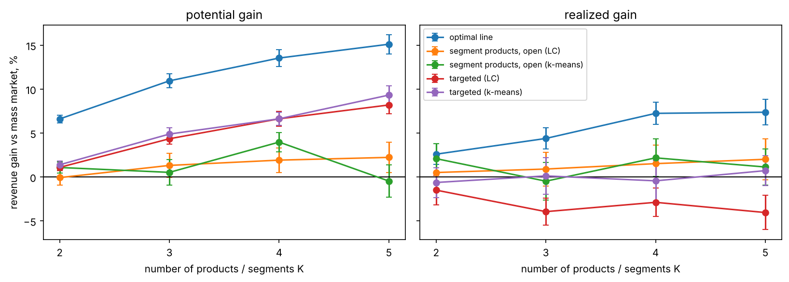
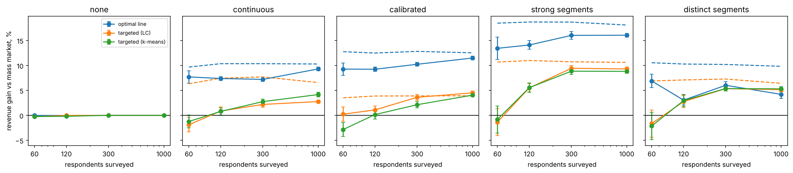
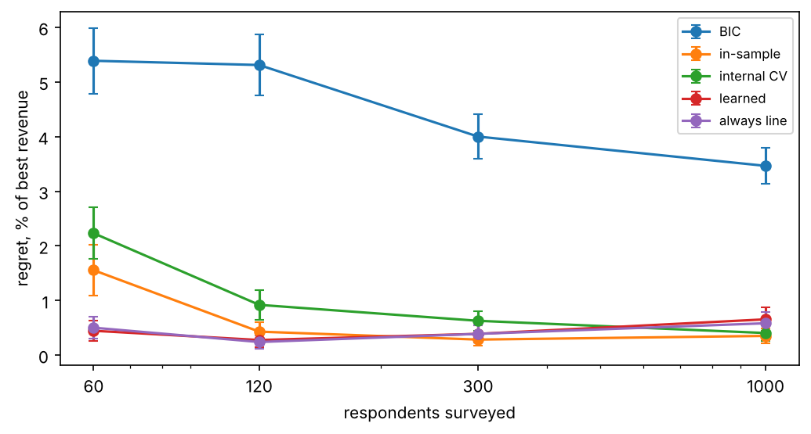

# Segmentation in conjoint analysis

When does it pay to split consumers into segments and design a product for each segment, compared with designing a product line directly from individual preferences?

I look at this with a ratings-based conjoint study on messenger bags and with simulations calibrated to the same data.

## Data

122 respondents rated the same 20 messenger bags on a 1-5 scale ("definitely would not buy" to "definitely would buy"). Bags differ in 6 attributes: exterior (black, reflective, colorful, blue), size (small, large), price ($120-$180), strap pad, water bottle pocket and interior (no dividers, file divider, padded laptop compartment). The same respondents rated the bags a second time offline.

The data come from a course and can't be shared. To run the code, put `design.csv`, `responses_online.csv` and `responses_offline.csv` into `data/`. The simulation results are saved in `results/simulation.csv`.

## What I did

1. [Data](notebooks/01_data.ipynb): design and ratings, scale use, online vs offline ratings.
2. [Preferences](notebooks/02_preferences.ipynb): pooled OLS, individual OLS and hierarchical Bayes (Gibbs sampler in numpy), compared on hidden bags.
3. [Segments](notebooks/03_segments.ipynb): latent class regression (EM at the respondent level, ratings centered per respondent) and k-means / Gaussian mixture on HB partworths; number of segments by BIC, ICL, holdout prediction and bootstrap stability.
4. [Revenue](notebooks/04_revenue.ipynb): mass market vs targeted segment products vs an optimal product line, evaluated out of sample with repeated cross-validation over respondents.
5. [Simulation](notebooks/05_simulation.ipynb): markets calibrated to the data with different heterogeneity structures and sample sizes (400 simulated markets).
6. [Robustness](notebooks/06_robustness.ipynb): other demand rules and whether segments replicate in the second (offline) measurement.
7. [Decision rules](notebooks/07_decision.ipynb): can the firm tell from its own survey whether to segment? Rules based on BIC, in-sample revenue, internal cross-validation and a regression trained on simulated markets (tested on market types left out of training).

Demand rule: a consumer buys the offered bag with the highest predicted rating if this rating is at least 3. Revenue is per consumer.

## Results

**There are no clear segments in the data.** BIC keeps adding segments up to 6-8, holdout prediction stops improving after 3 segments, only 2 segments are stable under resampling, and even 8 segments predict worse than HB. Preferences look more continuous than grouped.

**Out of sample, targeting segments does not increase revenue, but a product line does.** Products chosen on half of the respondents and evaluated on the other half, gain vs one mass-market bag:

| | 2 products | 3 products | 4 products |
|---|---|---|---|
| targeted segments (LC) | -1.5% | -3.9% | -2.9% |
| targeted segments (k-means) | -0.6% | +0.1% | -0.4% |
| optimal product line | +2.6% | +4.4% | +7.2% |

With known preferences, targeting would gain 1-7%. Most of this is lost because segment products are chosen from few people and new consumers are often put into the wrong segment.



**Targeting needs both distinct segments and a large survey.** In the simulation, targeting gains nothing with 60 respondents (between -3% and +0.2% across markets), gains 0-1% in a market like the real one at 120 respondents, and gets close to its potential only when segments are far apart and the firm surveys 300 or more people. The optimal line gains in every market with heterogeneity, already at 60 respondents. The exception is a market of tight, well separated segments, where targeting is as good as the line or better. When nobody differs, no strategy gains anything.



**Deciding to segment because the segmentation model fits better is costly.** In the simulated markets, a firm that targets segments whenever BIC prefers more than one segment loses 4.5% of revenue on average compared with the best strategy. Choosing by revenue on its own sample (0.7%) or by internal cross-validation (1.1%) avoids most of this, and simply always offering a product line loses only 0.4%. On the real data, the BIC rule recommends targeting, which loses about 4% out of sample, while the revenue-based rules recommend the line.



**Robustness.** The same pattern holds with a purchase threshold of 4 and with a smooth purchase probability instead of a hard cutoff. Segments found in the online ratings replicate poorly in the offline ratings of the same people (adjusted Rand index 0.4-0.5 for 2 segments, about 0.2 for 3-4).

## Run

```
pip install -r requirements.txt
```

Then run the notebooks in order. Notebooks 5 and 7 load `results/simulation.csv` and `results/decision.csv`; without them the simulations take about 20 and 45 minutes.

## Structure

- `src/` - functions (data, models, segments, optimization, cross-validation, simulation)
- `notebooks/` - analysis
- `figures/` - figures used here
- `results/` - simulation output
